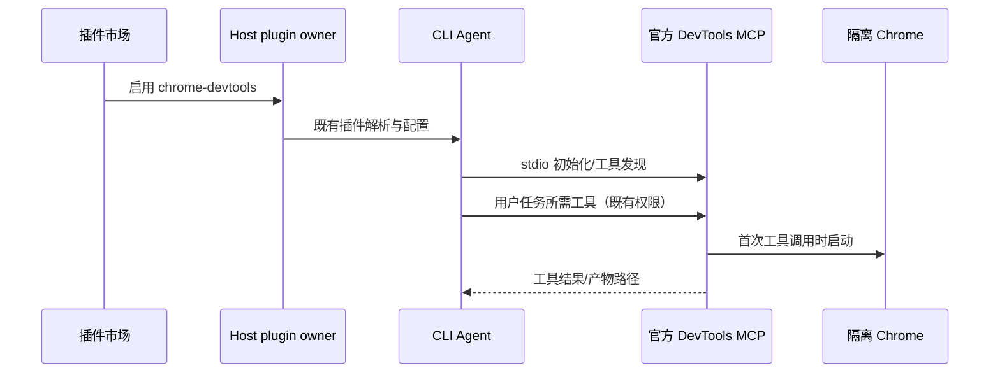

# Chrome DevTools 内置能力

## 范围与所有者

内置插件 `chrome-devtools` 固定官方 `chrome-devtools-mcp@1.13.0`，通过既有官方插件市场展示、启停、卸载和恢复。默认关闭，用户在插件市场启用后使用。与现有 Electron 内置浏览器操作分开：官方工具管理自己的 Chrome，默认隔离 profile，不自动连接个人浏览器或现有 CDP 端口。

插件随包提供 MCP server、CLI 和上游技能，构建时安装依赖并复制运行产物，运行时不使用 npx 下载。CLI 包没有生产依赖，可直接由 ZenCode 随包 Node 运行。上游 Apache-2.0 许可证和来源随产物保留。当前仓库包含八个技能目录（README 列七个），全部按上游版本提供。

- 默认关闭上游使用统计和 CrUX 远程查询；不自动打开调试端口或改变 Chrome 安全设置。
- 浏览器分析依用户任务启用，不向普通任务注入整套工具。启用后的 MCP 工具沿既有权限检查，并参与 TokenEconomizer 的使用证据与恢复机制。
- 性能 trace、网络、heap、Lighthouse、录屏能力以该版本实际 tools/list 为准，不根据宣传文案承诺。
- CLI 通过插件 scripts/cli.mjs 提供；调度复用现有 automation，不创建新的 cron 服务。
- Desktop/macOS/Windows/Linux 和远端 staging 使用同一插件资产。远端调用操作远端 Chrome；没有 Chrome 时明确报错，不连接本机 Chrome。

## 验收

构建产物完整性、固定版本、技能与许可、禁用遥测配置、CLI help、真实 MCP tools/list 与浏览器本地测试页；官方 seed 及桌面/远端 asset 清单一致；不替换原有 Browser Use。无 Chrome 的平台仅验证打包合同，不虚报浏览器实测。

## 验证（2026-11-16）

- 固定 npm 包运行资产构建成功，CLI --help 成功。
- 真实 stdio MCP initialize 成功，返回版本 1.13.0；启用 memoryDebugging 后 tools/list 为 46 项，包含 Lighthouse、trace、网络、heap 和 screencast 工具。
- 在本机 Chrome 上 list_pages 和 new_page 成功；未对每种分析工具或 Windows/Linux 的浏览器执行做全覆盖实测。
- 官方 filesystem seed 正确生成插件缓存，MCP manifest 使用既有 plugin-host 重写为 ZenCode 运行时；SEA 采集验证包含新增 12 个插件、641 个资产文件和许可证。
- 默认关闭；通过现有插件市场启用。没有修改用户已安装应用或发布安装包。
