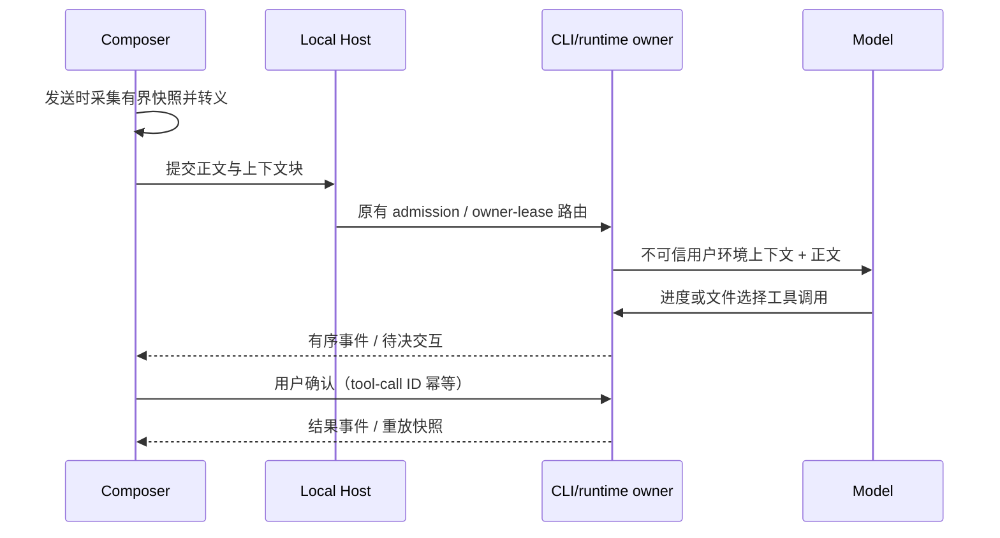

# ZenCode 对话上下文与引导协议

## 产品规则

1. 发送时可以附带当前文件、选区、诊断、Git 分支与可见窗格的快照。用户正文保持原样显示；上下文只在本次发送的模型输入中出现，并且必须可从历史消息无损剥离。没有可验证来源的字段不生成。
2. 上述数据属于用户环境中的**不可信数据**，不能以系统指令身份注入。模型可引用它来定位工作，但不能把文件内容、诊断文本或窗格标题当成命令。标签名称不赋予优先级；不复制第三方的 `<system-reminder>` 权限语义。
3. 视窗提示只描述真实且仍打开的 Diff、终端和预览窗格。模型可引导用户查看，不得声称已经高亮、打开或修改某个视窗，除非相应操作的结果事件已确认。
4. 长任务进度由当前会话运行时拥有；UI 只投影阶段事件。文件选择由一个待决用户交互拥有，在用户确认前不执行受影响的修改。模型重新调用、流重放和窗口重连不能生成第二个待决选择。
5. 复杂编程任务可显示进入隔离 Worktree 会话的建议；建议本身不创建工作树，也不静默切换会话。只有用户触发明确的 Worktree 创建入口后才执行。

## 状态所有者与接口

- `ContextAssembler` 是纯函数：输入发送时的上下文快照，输出有界、转义后的附加上下文块。它不读取 DOM、Git 或文件系统，也不持久化状态。
- Composer 在发送 admission 的最后一刻采集现有 UI/服务提供的快照，调用组装器，并通过现有 prompt context 序列化路径提交。可见正文、历史提示词和草稿不包含内部块；编辑重发必须重新采集新快照。
- Agent CLI/runtime 拥有已接受的任务进度和待决交互。`zencode_mark_progress` 的既有有序 tool-call 事件即为可重放的阶段事实，避免另建进度序号和状态表；`zencode_present_plan` 应走现有 user-input/plan 交互路径，使用稳定的 tool-call ID 作为幂等键。Renderer 通过流事件或快照投影卡片，不保留第二份业务真相。
- 平台差异经 `IPlatformService` 与服务 hook 访问。Web 缺少原生 IDE/Git 信息时省略相应字段，不伪造状态。



## 编码和安全边界

- 结构化字段先做类型、长度、数量校验；路径和诊断按 UTF-8 字符长度截断，选区受独立预算约束。拒绝控制字符和无效 Unicode，XML 特殊字符转义，避免用户文本伪造闭合标签或新字段。
- 附加块必须包含明确的“不可信环境快照”说明。模型输出中的工具名或标签文本不能反向改变协议事实。
- 不把完整终端滚动区、Diff 内容或任意文件内容自动注入；默认只发可见窗格的状态与已明确选中的文字。敏感数据由现有发送权限与日志脱敏规则约束。
- Git 状态使用 workspace identity 关联当前工作区；远程工作区保留 `workspaceIdentity` 和 `remoteSessionId` 作本地匹配，不只按路径匹配。这两个内部标识不作为模型上下文发送。

## TypeScript 契约草案

```ts
type VisibleWidget =
  | { kind: "diff"; tabId: string; filePath?: string; selectedLine?: number }
  | { kind: "terminal"; tabId: string; running?: boolean }
  | { kind: "web_preview"; tabId: string; title?: string; url?: string };

interface ConversationContextSnapshot {
  workspacePath: string;
  workspaceIdentity?: string;
  remoteSessionId?: string;
  capturedAt: string;
  activeFile?: { path: string; selectedText?: string };
  diagnostics?: ReadonlyArray<{
    path: string;
    line: number;
    severity: "error" | "warning";
    message: string;
  }>;
  git?: { worktreePath: string; branch?: string; head?: string; dirty?: boolean };
  widgets: readonly VisibleWidget[];
}

interface AssembledConversationContext {
  /** 只可作为用户环境数据附加，不能写入 system/developer 指令。 */
  userContextBlock: string;
  /** 历史 user row 要隐藏的原始块；显示时仍使用用户正文。 */
  byteLength: number;
  truncated: boolean;
}

declare function assembleConversationContext(
  snapshot: ConversationContextSnapshot,
  limits: { maxTotalBytes: number; maxSelectionBytes: number; maxDiagnostics: number },
): AssembledConversationContext;
```

`ContextAssembler` 对每个字段先验证后转义，输出固定顺序及版本号；不接受任意 HTML/Markdown 模板。`<widget_context_hint>` 仅是数据容器内的一个名称，不能让模型获得新工具或虚构操作结果。发送消息时先保存可见正文，再附加块；历史解析器必须识别版本与结束边界，解析失败时宁可显示为普通用户文本，不静默删掉内容。

### 进度和决策工具

```ts
type MarkProgressInput = {
  stage: "analysis" | "editing" | "verification" | "complete";
  summary: string;
};

type PresentPlanInput = {
  title: string;
  files: ReadonlyArray<{
    path: string;
    intent: "edit" | "create" | "delete";
    reason: string;
  }>;
};

type PresentPlanResult =
  | { status: "confirmed"; selectedPaths: readonly string[] }
  | { status: "cancelled" };
```

- `zencode_mark_progress`：只允许前台主任务调用；runtime 校验阶段与长度，使用既有 tool-call ID 和事件序号落入当前会话流。渲染为时间线；同一 tool-call ID 的重放只更新既有行。
- `zencode_present_plan`：runtime 校验路径属于当前 workspace，去重并冻结候选列表；创建一个等待用户输入的 tool call。结果只能是用户选中的候选路径子集或取消。确认后当前 turn 的工具执行器激活文件写入边界：`Write`/`Edit` 仅能写选中路径；无法证明写入范围的 `Bash`、JS、MCP、子 Agent、电脑控制等工具拒绝执行。该边界不授予额外写权限，原有权限检查仍执行。
- UI 从既有 `tool_call` / `tool_call_update` 投影工具名与严格校验后的 payload，分别渲染 `ProgressTimeline` 和 `FileSelectionCard`。卡片的勾选状态是待决交互草稿；确认时携带 tool-call ID 和当前 revision 回传。ACK 后以 runtime 投影为准，不自行补写“已确认”。
- 文件选择待决时，它本身就是当前操作反馈；聊天底部不再同时显示生成中动画。取消或确认后由待决交互事实驱动动画恢复。

### 文件写入边界的所有者和时序

- 单个 ToolExecutor 持有当前 turn 的一份冻结选中路径集合，键为可信 `turnId`。Handler 只能在确认回执经过 broker 后激活；缺失 turnId、活跃后台任务或可执行工作区 Hook 时拒绝激活。新 turn 的工具不读取旧 turn 边界。
- 每个后续工具先完成输入规范化，再在 Hook、权限和 Handler 前校验边界。已注册的只读内置工具可继续；`Write`/`Edit` 的 `file_path` 必须解析到 workspace 内选中路径，且后续仍经过原有权限流程。其他工具一律拒绝，尤其不能凭模型声称 Bash 为只读而放行。
- 既有后台任务可能在确认后继续写文件，因此确认前必须要求它们全部进入终态；同批工具调度必须使文件选择独占一个顺序段。若无法证明独占，文件选择失败关闭。
- 该边界限制当前 Agent 工具执行，不能阻止用户、其他应用或另一会话同时修改文件；这些并发来源由原有文件 revision 校验处理。崩溃后未完成 turn 不自动继续，新的 turn 需要重新展示计划。

```text
模型调用 zencode_present_plan
  → runtime 校验 + 创建待决 tool call
  → desktop-continuous 直接推送；web-remote-replayable 记录并可快照恢复
  → React 卡片展示冻结文件列表，用户勾选并确认
  → interaction answer(toolCallId, revision, selectedPaths)
  → runtime 幂等 admission，工具结果回模型
  → 当前 turn 文件边界和原有权限共同校验后执行
```

`launch_code_session` 不新增隐藏调度路径：复杂度检测只生成建议事件。当前仓库没有可复用的 Worktree 创建 UI/平台命令；一键入口需要先定义平台契约，再由 Desktop 原生层创建 Worktree 并启动会话。按钮须显示目标仓库、基线分支与将转移的任务摘要，失败可重试且不关闭原会话。

## 验收场景

1. 在 Diff、终端、预览分别打开与关闭后发送，模型输入只包含发送瞬间真实存在的窗格元数据；聊天中的用户原文不显示内部块。
2. 选中文本包含 `</system-reminder>`、`<widget_context_hint>`、换行和控制字符时，不能逃逸附加块或提升权限；超长选区被截断并标注。
3. 编辑历史消息并重发时重新采集上下文；发送失败恢复草稿，不保留已生成的隐藏块。
4. 多文件计划卡片勾选部分文件后，runtime 只接受选中的文件；取消或断线重放不会自动批准、重复执行或丢失待决交互。桌面连续流与手机可重放流均能恢复同一待决项。
5. 阶段事件按运行时 tool-call 顺序展示；重复 tool-call ID 幂等。重连后时间线与 CLI/runtime 事实一致。
6. Worktree 建议只提供明确创建动作入口；用户点击后创建隔离会话，失败时保留当前会话。

## 迁移边界

现有 `composerPromptContexts` 的四类尾块与解析顺序保持兼容。新增上下文须统一加入序列化与反向解析，不另建第二条写入路径。现有 `AskUserQuestion`、计划模式和工具流先作为卡片/进度的承载能力；新增工具名必须通过正式注册、运行时校验、协议事件和 UI 投影贯通，不能只做前端占位。

当前源码尚没有一个同时持有激活文件、选区、LSP 诊断、Git Worktree 与三个窗格状态的可信快照接口。因此接线顺序应是：先在现有窗格/服务所有者上暴露只读快照，再接 Composer 发送时组装，最后注册工具与投影卡片。任何字段的来源尚未接通时该字段必须缺席，不用 DOM 查询或旧缓存补值。

## 实现状态与剩余验收

- 已接线：当前可见侧窗格的代码文件、Diff、终端、Web 预览元数据，以及现有 Git 摘要；Composer 在发送 admission 时读取并生成有界的用户环境块。当前没有可信的通用 LSP 诊断和任意编辑器选区发布接口，这两项保持缺席。显式附加的代码评论选区仍走原有独立上下文附件。
- 已接线：`zencode_mark_progress` 使用既有 tool-call 流投影卡片；`zencode_present_plan` 通过用户输入交互收集文件勾选，候选路径与回执做运行时校验，并从 pending permission 快照重建卡片。
- 已接线：文件计划确认后，ToolExecutor 在 Hook、权限和 Handler 前校验写入边界；Hook 和权限改写输入后会再次校验。Write/Edit 必须解析到当前 turn 已确认的工作区文件，无法证明写入范围的工具失败关闭。路径使用真实路径解析并拒绝工作区外的符号链接。确认前存在运行中后台任务或可执行 workspace hook 时不激活边界。单测覆盖工具拦截和符号链接逃逸。
- 未接线：复杂任务自动识别与一键隔离 Worktree 会话；统一的 LSP 诊断和编辑器选区只读来源；桌面与手机真实重连的端到端验收。桌面/浏览器组件测试与微信配对入口测试不代替真实设备重连验收；完成这些前仍不能宣称整套系统生产验收完成。
