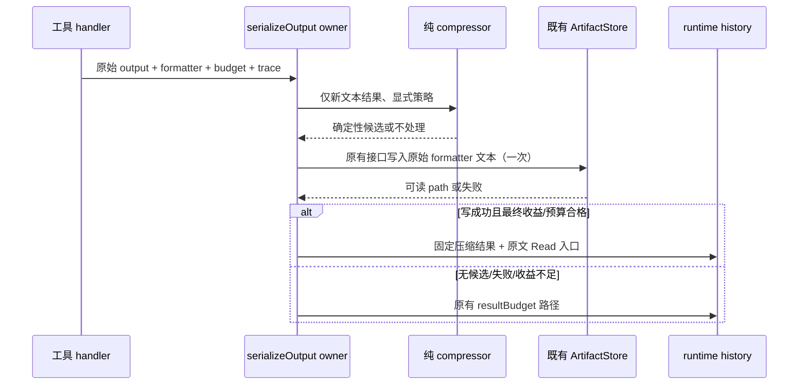

# 工具结果的确定性、可取回压缩

## 来源与取舍

参考 [OptScale Kompressor](https://github.com/hystax/optscale-kompressor/tree/91156bb29c05b2fa6b10f4ca2db5aa9e538f228c) 的 deterministic compression、log template folding、file-grouped search 和 recoverable elision 机制（MIT，Copyright 2026 Hystax）。本次独立实现 TypeScript 规则，不复制 Rust 源码，不引入二进制、模型调用、代理、额外鉴权或数据库。上游公开的节费百分比是其特定基准，不代表本项目效果。

现有 resultBudget / artifact store / Read / session history 继续提供预算、原文取回及持久化。现有会话摘要、microcompact、图片/CUA 原子块、工具权限、provider cache markers、Desktop continuous 与手机 replayable 流保持原边界。

## 产品规则

1. 仅工具显式声明 `resultBudget.textCompression` 时启用；首批为 Bash 的 logs 与 Grep 的 search。没有声明的 Read、Edit、MCP、结构化媒体等沿用原行为。不改用户请求、系统提示词、源码、JSON、配置或 diff。
2. 在工具结果第一次序列化、写入模型可见历史**之前**处理；不随最新问题、历史长度、时间或模型变化重新评分和改写旧结果。相同输入、规则及 artifact 引用产生相同文本，已压缩或已有 persisted-output 包装的结果不重复压缩。
3. 输入小于 4096 UTF-8 bytes 或大于 1 MiB 时不尝试。日志仅折叠明确的日志/构建状态行：普通文本、数字指标、路径列表和源码不猜测成日志；除日志时间戳外不归一化数字、文件名、ID。保留首 8 行、尾 12 行、所有错误/警告/退出/中断信息及其相邻 3 行。分节标记隔开折叠域，原顺序不变。
4. 搜索仅识别明确的 `path:line:text` 或 `path-line-text`，兼容 Windows drive 与带日期/连字符路径。同一文件保留首尾各两条命中、所有诊断命中及邻近上下文；不删除整份文件、不改变文件路径或行号。普通文件列表/count 模式不采样。省略位置明确计数。
5. 含 marker、取回说明在内的最终结果必须至少缩小 20%、净省至少 256 个**估算** token，且不超过现有模型字节预算；否则走原路径。token 估算复用本项目函数，不能把估计写成真实账单节省。
6. 原始 formatter 输出通过现有 `ToolArtifactStorePort` 写入成功、有 `path`（Read 可访问）后，才可发送省略内容；只有不可供 Read 使用的 URI、无 store、写失败时不发送新的压缩投影。保留既有 budget 截断/落盘失败语义。不伪造引用，不用用户正文内的路径当作写成功依据。
7. 输出明确说明省略及 `Read` 原文入口，保留原始执行结果、UI display 和终止状态；仅模型投影缩减。Hook 附加上下文仍由原路径追加。统计复用 `originalBytes` / `returnedBytes`，debug 只记录 aggregate、工具与 trace，不记录内容或凭据。
8. Abort 在压缩落盘前后检查；使用原 toolCallId / session / turn / trace，沿原 artifact retention 与读权限边界，不创建第二套缓存、队列、去重索引或状态 owner。

## 契约与所有者

- contracts `ToolResultBudget.textCompression?: "logs" | "search"` 是可选能力声明，不改变既有调用者。
- core 的纯 compressor 仅输入文本和策略，输出候选文本与省略数量；候选不代表已成功取回。
- 既有 `serializeOutput` 是结果预算/原文持久化/最终模型投影的唯一决策点。压缩候选和原超限条件共用一次 artifact 写入；只有最终完整投影收益足够才采用。
- adapter `ToolArtifactStorePort` 拥有落盘，runtime history 保存一次最终投影；Main、Host 和 Renderer 不新增业务状态。

## 验收与验证

- 确定性、重复应用不扩张、短文本/源码/JSON/diff/已有 artifact 包装不处理。
- 重复日志缩短；数值变化不合并；中部错误/警告、堆栈、退出码和 Unicode 原样保留。
- 搜索多文件、Windows/日期路径/上下文分隔符，保留每个文件和关键命中，省略计数准确。
- 真正的 serializer 集成验证默认/显式禁用、原文只写一次、可按 path 无损读取、无 store/写失败/只有 URI 回退、取消、Hook 与媒体不变。
- 不变更历史前缀：在相同已序列化结果后追加问题时，不重新运行/修改该结果。桌面和手机事件继续承载相同原始 output、display、toolCallId 与最终模型结果。
- 合成日志/搜索语料报告输入/输出 bytes 与估算 token、诊断留存和耗时；运行根目录和 CLI 各自 typecheck/lint、目标测试及 architecture changed 检查，单独报告基线失败。

## 实测记录（2026-10-23）

合成重复构建日志含 ERROR 和堆栈：原始 22,395 UTF-8 字节，最终带完整原文引用约 2,445 字节（临时路径长度会影响结果），减少约 89%。测试验证原文逐字落盘读回、诊断保留与写入期间取消。仅为合成样本的上下文体积，token 使用现有粗估函数；不代表所有工具输出或实际计费节省。
