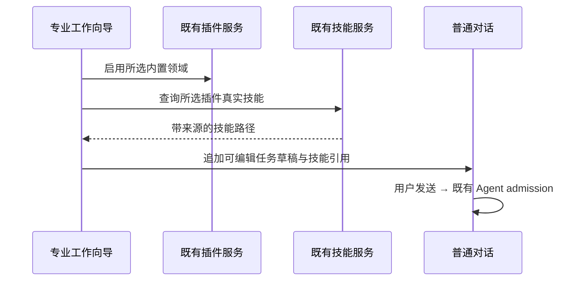

# 知识工作引导式入口

源：anthropics/knowledge-work-plugins，固定 e91a134584eb798bac7fb0379358006a2b63b965，Apache-2.0。

## 产品规则

首批集成原始 11 个领域：销售、营销、客户支持、产品管理、效率管理、数据分析、财务、法律、生物研究、企业搜索、插件定制。当前上游新增领域不自动扩大内置范围。

每个领域作为独立官方内置插件，默认关闭。保留上游 Skills、现有 Commands、参考文档与许可；manifest 适配 ZenCode，命名 knowledge-<domain>，避免同名来源冲突。上游连接器配置留作模板，不自动注册或授权；用户使用既有 MCP 设置连接所需服务，空 URL 不作为可运行配置。

UI 新增互斥的「专业工作」入口：领域 → 目标与材料 → 数据来源 → 确认。只启用选中的领域，选取该插件的真实技能路径构造 mention，生成普通对话草稿（不自动发送）；用户可继续附加文件、选择模型和修改要求。保留已有聊天草稿，不覆盖。任务与后续导引使用既有会话 admission。引导期间不调用模型。

数据来源允许本地材料或已授权连接器；后者提供既有 MCP 设置入口，不把“选中”伪装成“已连接”。无法解析到官方技能时保持引导并显示错误，不提交无效路径。插件管理由既有 service/store 所有；UI 只保留当前向导草稿。离开页面、切换 workspace 后的异步完成不能写入另一个 workspace。

桌面/Web 共用组件与服务，保持 workspaceIdentity 优先；不新增远程状态所有者。默认不开启外部写入、发信或资金动作；执行遵循用户请求、既有权限与上游专业流程。

验收：11 个插件的许可与技能完整，构建/seed 包含资产；向导切换步骤与必填校验；本地/连接器分支；错误可重试；只选择一个领域；保留普通对话草稿；桌面/窄屏入口互斥；无隐藏模型调用。

## ZenMux 模型分级

专业向导与 WorkCoder 共享 ZenMux 公共 models API 的有界缓存（10 分钟，超时 10 秒）。仅在入口打开时取目录，无 API Key、无模型调用；候选取当前 provider 已配置模型与目录交集。仅 text 输出模型参与推荐；成本档以每百万 Token 的 input+output 单价粗分 <=2 轻量、<=12 均衡、其余深度；这是成本档而非能力排行榜。深度建议还要求 reasoning=true 与 context>=128K，资料不完整不自动推荐；用户可手动选任意已配置适用模型覆盖推荐。混合币种/计量单位和多档价不做猜测。主会话默认均衡、只读研究轻量、顾问深度；不绑定厂商或模型名，不自动新增付费模型。

## 验证（2026-11-16）

- 11 个领域资产与 DevTools 的两项完整性测试通过，连接器模板不会自动注册。
- ZenMux 分级两项测试通过：不同厂商/未知名称按公开元数据分类；非文字、缺价格、多档价格、错误计价单位不自动分级。
- Professional work 与 WorkCoder 的英文桌面、中文 390px 窄屏浏览器测试通过：必填门禁、可重试错误、官方技能引用、模型覆盖、已有探针导出与图表。WorkCoder 缺少模型时不会创建固定 Haiku 模型。
- Root typecheck 通过；Root lint 76 warnings/0 errors；架构检查 0 violations；Bootstrap build/typecheck 通过。Bootstrap 自带 lint 命令被 ignore 规则过滤为零文件，改用 --no-ignore 对两个改动文件检查，0 warnings/0 errors。
- 模型目录已通过公开 ZenMux API 读取；分级不是能力基准测试或任务成功率保证。前端流程使用受控 fixture，第三方连接器的真实登录授权未执行。
