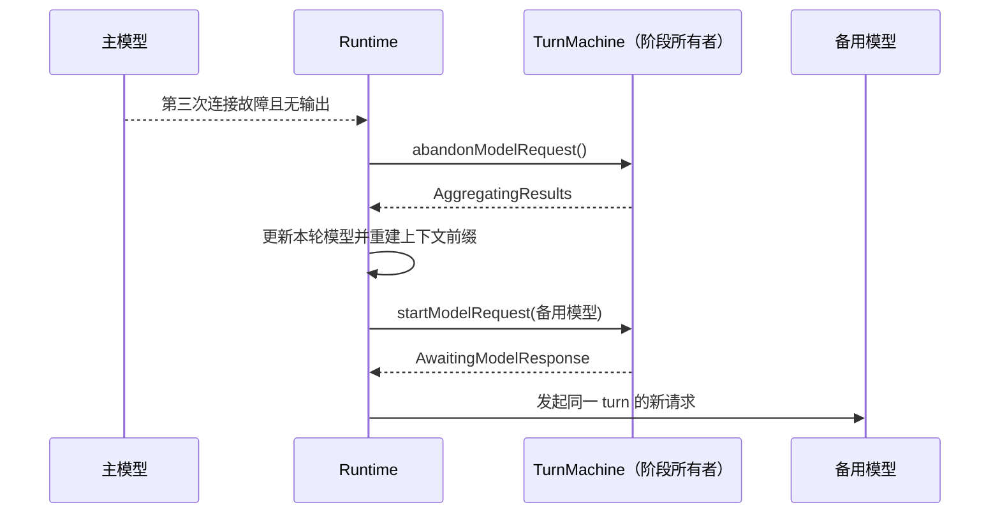

# 连接故障备用模型

设置保存可选的 providerId/modelId。Host 设置为唯一持久化所有者，经已有 session runtime preferences 传入 Runtime；新建/恢复 runtime 读取设置。默认关闭，不自动猜测等效能力。

模型网络失败事件 → 当前请求连续计数 → 第三次连接/超时失败（含首次请求，共三次尝试） → 中止主模型请求 → Runtime 换用用户备用模型 → 重建下一次请求。已有可见输出或工具调用时不自动重放。非网络故障与用户停止不触发切换。每次主请求最多切换一次，同模型不切换；备用仍失败走正常错误处理。切换保留会话与工具历史，使用备用模型自身能力及 token 限制。

记录切换模型标识/原因/次数，不记录凭据或正文。产生现有 ModelSelected 事件供 UI 展示。默认模型选择不永久改写。Desktop/Web/远程共用 Host preferences 协议；旧 Host 缺字段按关闭处理。

备用选择包含 options.reasoningLevel，与系统 completeNewModelSelection 和模型 optionSpecs 共用，用户主动选模型默认系统最高支持档，之后可自行调整。关闭用 null 持久化，避免 undefined 经 RPC 序列化丢失导致无法关闭。远程 workspace 的 Host preferences 走相同字段。

入口同时展示于通用设置和模型设置顶部，使用同一 ConnectionFallbackSettings 与设置服务，不创建第二份偏好。模型设置中的备用选择保持原环境边界，不混入供应商编辑的本机服务覆盖。

达到三次后立即取消主请求并交接，不等待剩余 adapter 重试预算；交接触发后的取消回调不清空触发次数。备用模型沿用用户设置的 options.reasoningLevel，不继承主模型档位。

## 失败请求的阶段交接

`TurnMachine` 是当前 turn 阶段的唯一所有者。连接故障触发备用模型时，原请求已经进入 `AwaitingModelResponse`，但没有可提交的正文或工具调用。Runtime 先让状态机将该失败请求标记为已放弃，进入 `AggregatingResults`，再更新本轮模型选择并由现有循环启动下一次请求。这个阶段交接不写入虚构的 assistant 响应，也不创建新 turn；下一次请求沿用同一 turn 和已有历史。若失败前已有输出或工具提交，则禁止此交接，沿原错误/恢复路径处理。

验收：连续第三次网络失败且无输出时，主模型请求从 `AwaitingModelResponse` 进入 `AggregatingResults`，备用模型请求可以正常进入 `AwaitingModelResponse`；没有额外消息或工具结果。普通完成、用户停止、非网络错误和备用模型再次失败保持原有处理。Desktop 实时流与手机恢复流继续共享同一个 turn owner，不另建队列或快照。
