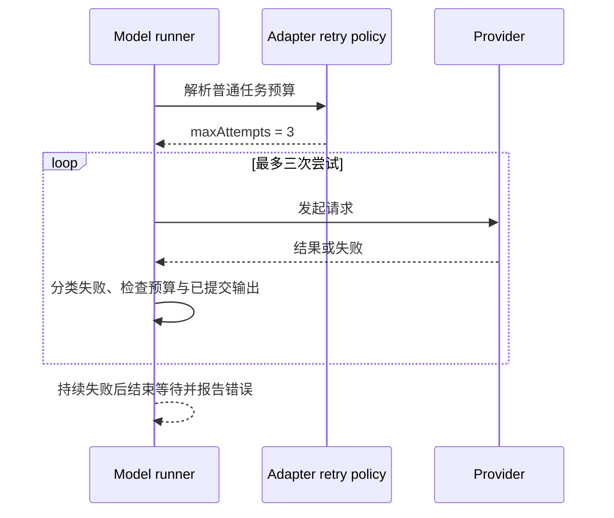

# 普通模型请求的重试预算

普通任务默认允许首次请求和两次自动重试，总计最多三次尝试。AiSdkModelAdapter 的 retry-policy 是预算解析的唯一所有者，runner-stream 与 runner-generate 继续使用同一解析结果，界面沿已有状态事件显示两次重试。

显式 options.maxAttempts 优先于 ZCODE_MODEL_RETRY_MAX_RETRIES，环境变量优先于默认值。零次重试、显式自定义次数及无上限任务的现有入口仍按所选配置执行。服务端不可重试错误和已提交输出边界继续由已有分类与流边界规则处理。

验收覆盖默认三次尝试、环境变量设零关闭重试、显式自定义次数优先级、无效环境值回退。代理选择仍由当前启动环境提供；本次仅调整预算，不承诺运行中代理配置热更新。

验证记录（2026-11-13）：3 项预算回归通过，修改前默认预算断言为 11 次、修改后为 3 次；完整类型检查重建后通过，Lint 为 0 errors / 76 既有 warnings，架构检查 0 违规。当前登录会话通过 ZCODE_MODEL_RETRY_MAX_RETRIES=2 配置现有安装版并重启应用；源码默认值的变更尚未重新打包发布。
