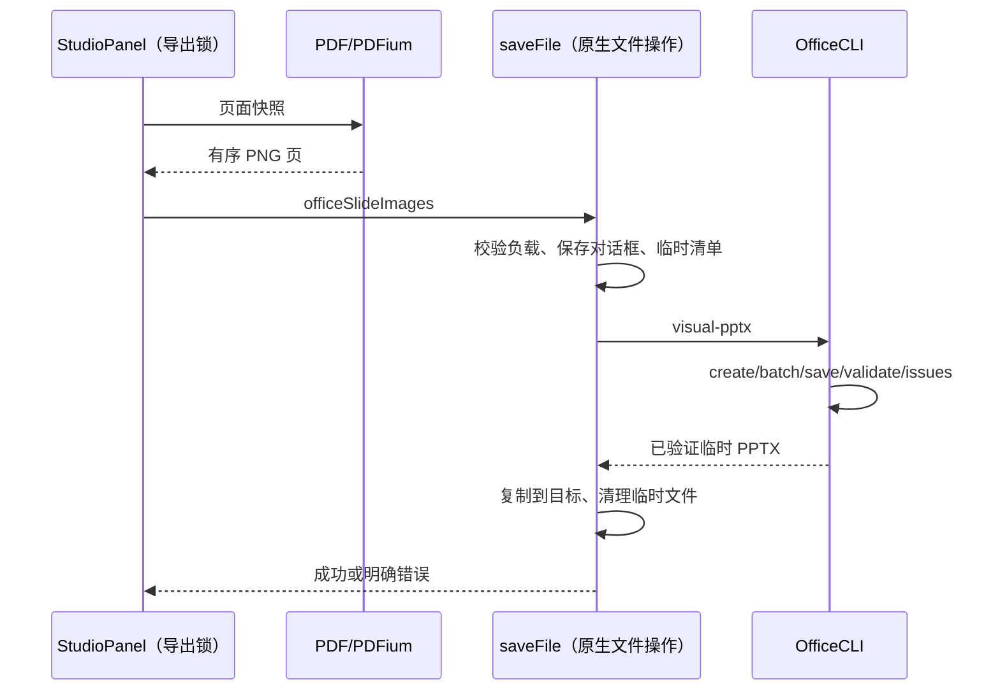

# OfficeCLI 兼容导出

## 产品规则

PPT 保真导出使用现有预览 → PDF → PDFium PNG 链路，然后由 OfficeCLI 构建一页一图的原生 PPTX，16:9，顺序和页数完整。该格式不支持元素级编辑，原可编辑导出不变。OfficeCLI 不具备已验证的原生 PDF 转可编辑 PPT 接口，不声称有此能力。

OfficeCLI skill 内置 compatibility.mjs，提供 visual-pptx（PNG data URI 清单 → PPTX）和 check（docx/xlsx/pptx 保存、OpenXML 校验、issues 报告）。默认不改用户源文件；所有输出先在临时目录生成和校验，成功后才发布到用户选择位置。schema 校验失败不得返回成功。issues 报告必须保留，不等同于 WPS/Office 视觉验收。

Desktop saveFile 增加 officeSlideImages 分支，只接收 PNG data URI、非空且最多 500 页、总解码大小最多 50MiB。Main 只执行文件导出和工具进程调度，不保存任务状态。UI 通过 IPlatformService 调用，同一 pdfExportLock 串行化。Web 没有原生 saveFile 实现时不暴露此入口。

## 所有者和顺序

## 打包

桌面与远程 skill 清单必须包含 compatibility.mjs。CLI launcher 保留固定版本与 SHA256 校验、离线缓存；打包预置的二进制仍必须验哈希，不能使用未验证系统工具。若用户级缓存文件存在但 SHA256 不符，launcher 删除这份已失效缓存并重新下载锁定版本；新文件通过 SHA256 后才原子发布和执行。下载或校验失败要报告具体错误，不能静默改用另一个导出器，也不能执行未验证文件。打包预置资源哈希不匹配仍须显式失败，以暴露安装包损坏。

Desktop staging 在复制 OfficeCLI 到 `bundled-agents/<platform>/glm` 后校验其 SHA256。macOS Developer ID 签名会改变 Mach-O 原始字节，因此签名前必须匹配上游 SHA256；签名后由 electron-builder 校验严格代码签名与固定 Team ID。安装时同样先校验上游 SHA256，若文件是已签名内置 macOS 资源，则验证严格代码签名与固定 Team ID。未签名、签名无效或 Team ID 不符均失败；用户缓存仍只接受上游 SHA256。其他平台的最终资源始终匹配 `release.json`。

## 验收

- 实际两页 PNG 经 OfficeCLI 生成 PPTX：页数两页、各一个图片、坐标 0/0、16:9、图片数据相同；validate 成功。
- 非 PNG、空清单拒绝；失败不能覆盖已有输出。
- check 支持 docx/xlsx/pptx，实际创建和检查 Word/Excel 样例。
- 人为损坏的用户级运行缓存被移除并进入已验证下载路径；未通过校验的二进制不执行，下载失败保留明确错误。
- 人为损坏 staging 输入及最终制品内的 OfficeCLI 都会被构建校验拒绝；正确资产在 macOS ARM64 staged 与最终 `.app` 路径校验通过。
- 现有 PDF/可编辑导出测试保持；typecheck/lint/architecture 实际执行。
- 没有 Windows Office/WPS 时明确未做对应视觉验收。
