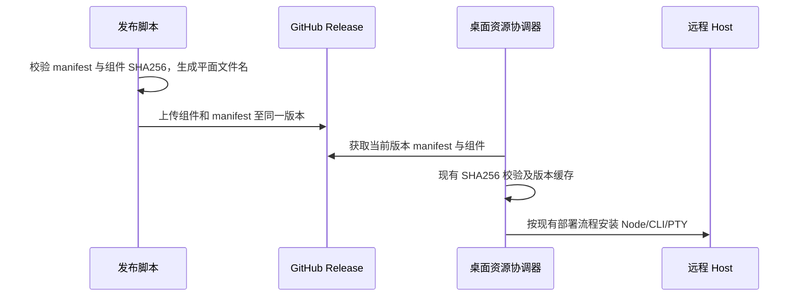

# 远程运行时发行

ZenCode 默认从自身 GitHub Release (`bennix/ZCode` 的 `v<应用版本>` 标签) 下载 SSH/WSL 资源，不依赖上游项目的 CDN。显式完整基址覆盖仍优先；配置自有 CDN 根地址时保留原有 `/zcode/electron/releases/<版本>` 规则。开发态 mock-cdn 不变。

发布脚本负责把四种平台 manifest 引用的组件映射成 GitHub 支持的平面文件名，保持组件 SHA256、mount 和版本不变；校验所有输入哈希和路径在 mock-cdn 内，缺少文件或摘要不符立即失败。清单随安装包在同一 Release 发布。GitHub 上的版本固定基址只探测自身，不先请求重复版本或父级路径；版本不匹配必须前置拒绝。服务器原有缓存、摘要校验、安装状态和 owner/lease 保持原规则。

验收：默认地址与自定义 CDN 兼容；GitHub URL 无双版本/错误父级探测，旧版本基址拒绝；发布脚本校验篡改输入和路径逃逸；公开资产摘要对应 manifest。Node 24.14.0 与打包 CLI/PTY 在可执行架构启动通过。未具备实际 SSH/WSL 目标时如实标记端到端会话验证范围。
