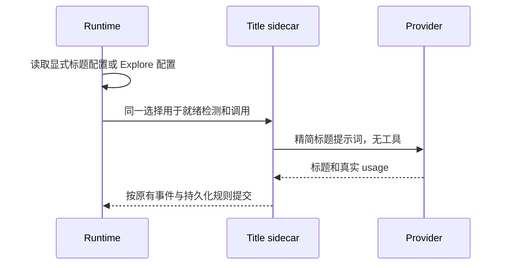

# 请求固定开销优化

依据简单任务实测，主请求 30,897 输入 Token、36 个工具，标题另耗 576 输入 Token。

工具注册及权限仍由 runtime registry 和既有 permission owner 管理。精简计划、定时任务及工作流描述的重复示例，保留输入 schema、运行时校验、权限与关键业务规则。全部请求复用相同精简定义。

标题模型依次采用显式 titleGeneration.modelSelection、已配置 Explore 模型、当前会话模型。标题就绪检测与实际调用必须使用同一选择规则。Explore 未配置时使用当前模型，不猜测 provider 模型名称。缩短标题提示词，继续将用户输入视为素材，严格返回 JSON 并保留语言与专有名称。

回归覆盖标题选择优先级、无配置 fallback、关键工具规则及定义体积。真实复测保留原任务、主模型、完整工具参数结构，通过固定请求对照验证用量与输出。字符节省不等于精确 Token 节省。安装版本更新前，源码变更通过独立请求复测。

本轮 11 项回归、core 及依赖构建、根 typecheck 通过。Lint 为 0 错误、76 项既有警告。真实 API 对照主输入减少约 9.4%，详细参数差异及用量见 output/token-pilot-20261113-report.md。本轮未打包安装版。

core 独立 Lint 为 0 错误、12 项既有警告，修改文件格式化通过。
