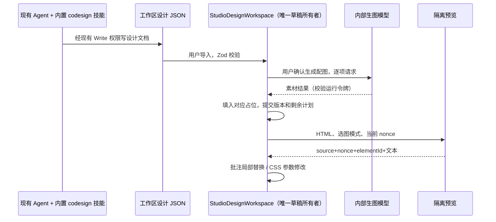

# 内置协同设计（CoDesign）

## 产品规则

- 参考 opencoworkai/open-codesign `4cf33932edc5f687e3cf7190261ebbb02c898d08`（MIT）的批注、参数微调、生图素材与本地作品工作流，原生 TypeScript 实现；不复制其账号、运行器与全套应用。
- 创作标签新增「协同设计」入口，与原「设计」共用 StudioDesignWorkspace 的 HTML、项目与版本所有者，避免两套设计草稿。
- 支持 prototype/poster/report/slides 四种作品意图。模型输出完整 HTML，并可在 `script#zencode-codesign[type=application/json]` 中附带严格校验的配图计划与微调参数。
- 内置 codesign 技能随 bundled-skills 分发，使用现有 Write 工具与权限边界生成 `.zencode-design.json` 文件。UI 导入/导出同一份共享版本化协议；缺少字段/未知字段/不安全 CSS 参数必须拒绝。技能不承诺不存在的生图工具：配图在 UI 通过内部生图链路执行。
- 配图复用 Studio 的默认生图模型、比例目录、密钥和 generateStudioImage；不添加第二套账号。显式点击生成（可能产生模型费用），逐项串行执行，完成一张便提交新版本并移除已完成计划，失败保留已完成素材与未执行计划；取消不提交过期结果，不自动重发已完成的付费请求。`{{IMAGE:id}}` 仅用于相应图片占位。
- 微调只修改受校验的 CSS 自定义变量（颜色、有限数值与单位），不发模型请求，不执行传入表达式。参数值写回 HTML 和版本，保存/导出可恢复。
- 点选批注模式只在用户开启时拦截 iframe 内点击。预览通过独立 nonce 和 event.source 检查向父窗口报告稳定 elementId 与有界可见文本。批注作为结构化反馈请求模型返回单一替换元素，严格校验 elementId 并只替换该元素；不应用模型返回的整页 HTML。
- iframe 继续 sandbox=allow-scripts，不允许同源访问；生成内容不获得密钥或文件访问。所有 postMessage 消息视为不可信数据，不作为系统指令。

## 状态与边界

- StudioDesignWorkspace 唯一拥有 html、brief、CoDesign 元数据和版本；新增 hook/面板只接收命令和派生投影。IndexedDB 保存项目快照，旧项目缺少 codesign 时使用空元数据。每个版本绑定自身元数据，回看不混用不同作品的配图或参数。
- 图片、模型请求由 AbortController 和唯一运行引用管理，前后校验；同一时间不能导入/切换项目或并发修改 HTML。
- 不改 Host/CLI 会话队列与 workspace identity；内置技能读写沿用当前工作区 Write 权限与文件选择 guard。Desktop 的连续链路和手机恢复链路不增加新状态队列。

## 验收

1. 新入口与旧设计共用已保存项目，可导入/导出 Agent 生成的设计协议；错误文件不覆盖草稿。
2. 配图请求使用配置模型与比例；两张图按顺序填入，失败保留前一张；取消后不执行下一张，不覆盖新项目。
3. 微调只改声明变量，非法 token/value 被拒绝，保存恢复与版本切换保持元数据一致。
4. 批注可定位元素，过期/伪造来源消息被忽略，局部替换不能更改兄弟元素。
5. 桌面和 390px 宽度交互可操作；内置技能与共享 schema 一致，打包必需资源包含 skill/schema。
6. 运行相关纯函数、浏览器 E2E、typecheck、lint、architecture；真实模型效果单独说明。

## 实现与验收记录（2026-10-26）

- UI：创作 → 协同设计；中英文入口，四种作品意图，设计文件导入/导出，参数微调，点选批注，逐项素材生成。复用原设计项目及版本；`useStudioCoDesign` 是同一工作区内元数据和操作的实现，不引入独立持久化。
- 内置能力：`bundled-skills/skills/codesign`，共享 JSON Schema 随 CLI 打包；Agent 使用现有文件权限写设计文件，用户导入后点击“生成素材”。不是独立模型工具或另一个账户系统。
- `studio-codesign.test.ts`：2 项通过，覆盖严格字段、CSS 注入、范围/重复值以及技能 schema 与打包资源一致性。
- `studio-codesign.browser.mjs`：Chrome 实际浏览器通过；390px 与桌面布局、导入、微调、点选/局部替换、兄弟元素保留、导出、非法导入、默认生图模型 URL/图片尺寸、项目保存重开、部分生成失败、取消和过期消息。模型响应使用 mock，不声称完成真实模型画质验收。
- `studio-creation.browser.mjs`：原创作工作区回归通过（姿态/参考图/生图请求/设计生成/导出/版本/取消/项目恢复）。
- `pnpm typecheck` 通过；`pnpm architecture:check --changed` 通过（0 违规）；`git diff --check` 通过。
- `pnpm lint` 实际执行，未全量通过：未修改的 `packages/services/src/setting/settingService.ts` 有现存 max-lines 错误（403 > 400），另有 76 个仓库警告。本次新增文件没有 Lint 错误。不调整既有基线绕过检查。
- 运行环境 Node v25.8.1；仓库 mise 钉住 24.14.0。未构建发布或生成 DMG。
