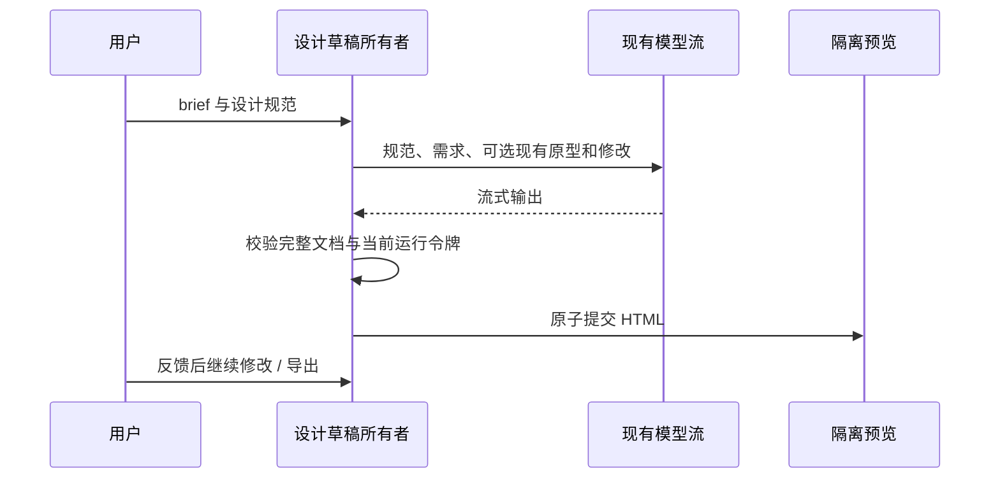

# 创作区设计工作区

## 规则与集成边界

在现有创作页增加「设计」入口，按 OpenDesign 的 brief → design system → prototype → feedback 工作流融合。第一阶段原生实现需求引导、设计规范、可交互 HTML 原型、桌面/手机预览、连续修改和 HTML/DESIGN.md 导出。不是外链入口，也不启动第二套 Agent。OpenDesign 的 daemon、云服务、多人协作、模板全库与 MCP 尚不移植，不将这些显示为已支持。

参考 nexu-io/open-design 的 design-brief 维度和 sandbox artifact 预览模式；新实现复用 ZenCode 当前模型、streamStudioChat 与平台文件保存能力，不引入供应商账号或密钥副本。

## 所有者与接口

- StudioPanel 持有媒体/设计入口选择；StudioDesignWorkspace 持有设计 brief、已提交 HTML、修改说明、流式输出与 AbortController。
- brief 包含目标、受众、平台、色板、字体、布局、气质、密度与限制；deriveDesignSystem 纯函数生成 DESIGN.md。
- generateDesignPrototype 通过既有 streamStudioChat 请求完整 HTML，完整响应校验后才提交；连续修改使用同一份已提交 HTML 与最新规范。
- iframe sandbox 只允许脚本，禁止同源、顶层导航、表单提交和网络访问；CSP 隔离生成内容。预览内容不读取应用凭据、DOM 或本地文件。
- 草稿属于当前创作组件，不提供跨设备/重启恢复承诺。
- 请求前取消旧任务；卸载取消；请求完成与输出回调比较运行令牌。失败或取消保留上次完整原型。导出使用 IPlatformService.saveFile，没有平台能力时明确禁用。

## 验收

- 创作页可在生图/视频/PPT与设计之间切换；媒体执行时禁用切换，设计执行时禁用切换。
- 填写需求、选择样式与平台后生成原型；能在宽屏/手机预览中操作，无页面宿主访问。
- 修改传入之前 HTML 和反馈；流式中/失败/停止保留之前文档。
- 导出 HTML 与 DESIGN.md；缺少文件保存能力时禁用且说明。
- 浏览器模拟模型验证生成与修改，纯函数验证规范、完整性与隔离约束。真实模型质量另行实测。

## 参考来源

- OpenDesign 源码快照：`78d5637cb49da07e81314d1544b5fc6d37c95084`（Apache-2.0）。参考 `skills/design-brief/SKILL.md` 的需求维度、README 的 design-system/prototype 工作流。当前为 ZenCode 原生实现，并未复制或打包 OpenDesign daemon/云服务。
- BodyFactory 参考：`src/js/local-stages.mjs`（MIT）中的分步参考隔离规则；ZenCode 通过原有云端生图接口实现。

### 生图素材衔接

- 设计区提供「使用当前生图」按钮；用户主动选择后将当前图片转成内嵌素材。模型收到图片和 `{{STUDIO_ASSET}}` 占位符，完成后在 HTML 中替换成 data URL，预览和导出无需访问图片服务。连续修改将同一素材收回占位符，避免将 base64 内容重复送入文字上下文。
- 图片仍由原创作区生成，设计区仅持有用户确认的素材快照；更换图片不自动更改已提交原型。素材读取失败明确显示错误。

### 本地项目（替代前述仅窗口草稿的限制）

- 增加本地设计项目列表、新建设计、保存当前项目、打开与删除。已保存项目包含 brief、原型、最多 10 个版本、素材与更新时间，不保存 API Key 或模型凭据。
- StudioDesignWorkspace 继续拥有未提交草稿；useStudioDesignProjects 通过 studioDesignHistory 存储持久化快照与列表投影，UI 不直接访问 IndexedDB。
- 用户显式保存，保存成功后才显示已保存；失败保留草稿并显示错误。保存/删除使用单一 admission 锁，事务完成后刷新列表；保存、删除、生成期间禁用项目切换。
- IndexedDB 删除 tombstone 与记录删除同事务，防止其他窗口的过期保存重新创建已删除项目。已删除项目不能以原 ID 保存，用户需新建项目。
- 验收：保存后新建并重新打开，恢复需求、规范、素材和版本；删除后列表消失且过期保存被拒绝；存储失败不丢失当前原型。

## 验证记录（2026-10-17）

- `pnpm typecheck`：通过。
- `pnpm lint`：通过，0 错误，76 警告（包含导入上游模型的 2 条警告）。
- `pnpm architecture:check --changed`：通过，0 violations。
- `pnpm exec tsx --test packages/ui/tests/studio-reference-stages.test.ts packages/ui/tests/studio-design.test.ts`：6/6 通过。
- `node packages/ui/tests/studio-creation.browser.mjs`：通过。使用实际 Three.js/WebGL 与模拟模型，覆盖 390px 窄屏姿态预设/身高/双人选择/PNG 捕获替换、分类与目标人物、4 次生图请求隔离、原型生成/交互/反馈/取消/版本/导出、生图素材衔接、项目保存/打开/删除与 stale-save 防护。另检查桌面预览截图。未调用真实模型验证视觉质量。
- 测试运行时为本机 Node 25.8.1；`mise.toml` 要求 24.14.0，本机标记 node@24 的二进制同样实际为 25.8.1。
- 已保留 BodyFactory MIT 原文并登记 copied-components。`node scripts/licenses.mjs notices` 未成功，原因是既有 `https@1.0.0` 缺完整上游许可声明；未覆盖原有 notices/inventory，未绕过生成器。
- 未执行 DMG 构建、公证或发布。
- 改动集中在 UI 创作模块及 hook/store、中英文文案、依赖与来源登记；统计时净增约 2914 行（含 678 行上游 Pose 源码和新增测试，不含原有无关未跟踪文件）。
