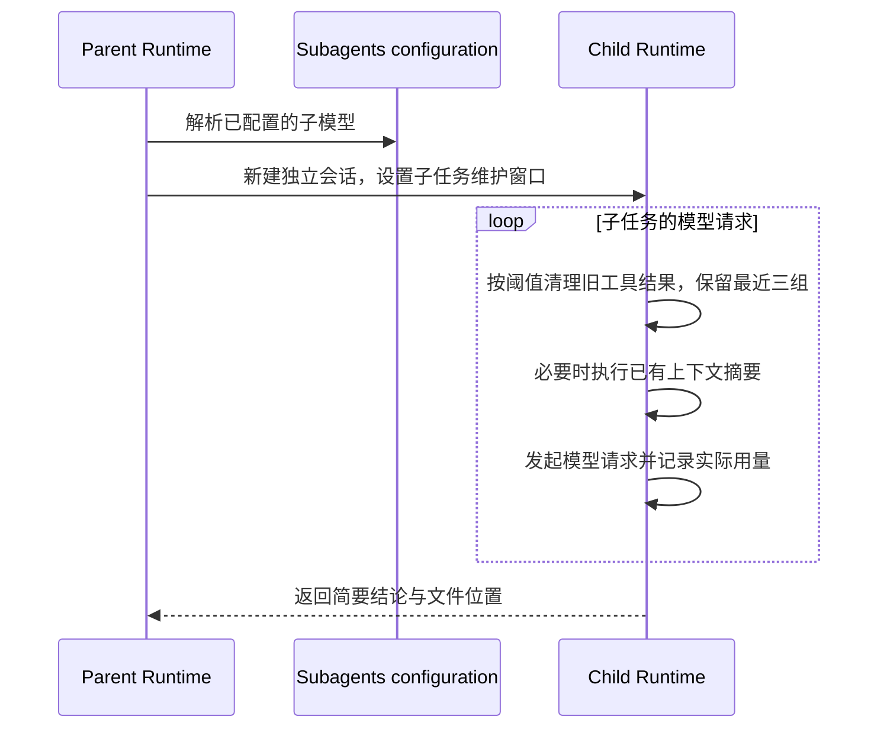

# 子智能体模型分工与上下文成本

## 规则与所有者

模型分工继续由 SubagentsService 的内置覆盖配置及 provider model registry 决定。本次将 general-purpose 配置为 Sonnet、Explore 配置为 Haiku，关闭两者的显式思考档位，并在模型设置中指定 96,000 上下文窗口及 8,192 最大输出。这些模型级设置适用于使用这两个模型的调用；已有子会话恢复时仍依据自身持久化模型状态。

新子 Runtime 的上下文维护由其自身 compact policy 拥有。未显式设置 compact.contextWindow 时，采用 96,000 的子任务维护窗口，并受实际模型上下文容量限制。已有显式压缩配置与关闭开关优先；主 Runtime 的配置对象不得被修改。

默认启用已有本地 microcompact，保留最近三个工具结果组，清理更早的可压缩工具输出。沿用原有工具调用配对、用户输入保留、canonical context 前缀保护、事件持久化与恢复路径。本地清理后仍超阈值时使用既有 autoCompact 摘要流程。该值是维护策略的触发窗口，实际请求仍受模型预算及压缩结果决定。

Agent 描述应要求独立且自包含的任务、明确的文件或模块范围、分段读取，以及避免重复执行已委派的搜索。只读查找优先 Explore，复杂分析或实现使用 general-purpose。

## 事件顺序

桌面实时投影和手机可恢复投影继续消费同一 child runtime 的 compact/microcompact 事件。模型配置、accepted task、lease 与工作目录身份由现有所有者管理。

## 验收

默认窗口为 96K，实际模型容量较小时取较小值；显式配置、关闭开关及 keepRecentToolResults 设置生效；父配置保持只读。使用大工具结果历史检查清理前后估算输入量，验证用户目标、工具调用元数据及最近三组结果保留。覆盖显式 Sonnet 子模型优先于父 Opus 的解析。当前应用配置需要经过重启加载验证；源码维护策略通过 core 构建、回归、根类型检查、Lint 与架构检查验证。

## 本次验证记录

核心及依赖包构建通过，模型选择、96K 默认策略、父配置只读、历史工具结果清理与重试预算共 7 项回归通过。合成工具历史验证清理后的估算输入低于清理前一半，属于夹具结果，实际任务费用仍需按 provider usage 测量。根 typecheck 通过，Lint 为 0 错误和 76 项既有警告，架构检查为 0 违规。

当前安装应用已通过设置保存角色、模型窗口及输出限制并重启。源码新增的默认 microcompact 策略尚需后续应用构建才能在安装版本中生效。旧子会话可继续采用持久化模型选择。

## 所有任务默认策略

普通对话、WorkCoder、CLI 与恢复会话在同一 Runtime 请求维护入口应用默认策略。主会话默认维护窗口 128K，子任务为 96K，并按当前执行模型容量取较小值。默认开启本地旧工具输出清理，主会话保留最近五组，子任务保留三组。显式窗口及禁用配置优先，模型切换后按新模型重新计算窗口。保持用户原始输入及现有 canonical prefix、工具配对和摘要持久化规则。模型选择继续使用全局子代理配置和显式任务配置。

验收覆盖缺省主会话、较小容量模型、显式窗口、禁用策略和模型切换时重新计算。桌面连续事件和手机 replay 继续消费现有压缩事件。

所有任务默认策略新增后，8 项回归通过，core 及依赖构建、根类型检查、架构检查通过。Lint 仍为 76 项警告与 0 错误。本轮未打包安装应用，统一默认策略需要新版构建加载。
