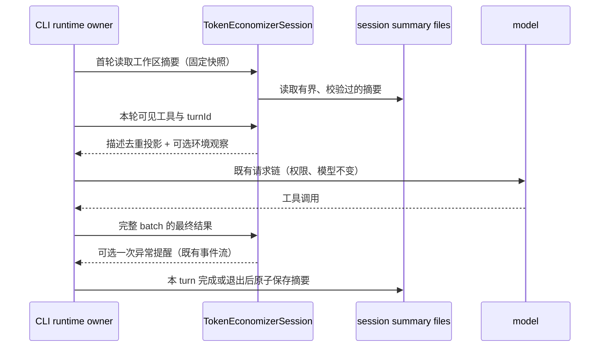

# ZenCode 内置 TokenEconomizer

## 产品规则

参考 microsoft/TokenEconomizer 的经验驱动节流机制，原生 TypeScript 实现，不要求用户安装 Python，不调用额外模型，不改变权限、选中模型、用户消息、原始工具结果或任务完成标准。参考版本：1deb887bb6816188e24580f8812e65288af5757c，Apache-2.0。不是上游插件的原样移植，也不承诺上游实验的节省百分比。

- 默认启用；`ZCODE_TOKEN_ECONOMIZER=off` 总关闭；`ZCODE_TOKEN_ECONOMIZER_MICROSKILLS=off`、`ZCODE_TOKEN_ECONOMIZER_TOOLPRUNE=off`、`ZCODE_TOKEN_ECONOMIZER_LOOPGUARD=off` 分别关闭。仅在 runtime 首次初始化读取开关，重启会话生效。
- Micro-skills 使用免费 envfacts 路径：仅识别固定工具链命令的 shell “command not found” / Windows “not recognized” 结果，至少三个独立会话确认后，下一会话提示检查工具链。成功执行相同命令后，下一会话快照撤销旧结论。不保存或注入任意输出、路径、命令参数、凭据。提示只是历史环境观察，不是命令或权限指令。
- 工具节流采用保守适配：至少两会话十轮未用，或五会话未用的 MCP 工具才进入优化候选；只折叠描述中完全重复的段落，保留所有不同文本、参数 schema、工具名与调用权限。代码块描述不处理；单会话目录固定，避免每步改定义破坏缓存。上游的禁用工具方案、付费 judge、模型生成微技能不在此次适配范围。关闭 toolprune 后恢复原始描述。
- Loop guard 与现有异常提醒共享预算：至少二十次工具结果、六次失败、同一失败重复至少三次且连续没有成功结果，才提示换假设。每个 turn 至多一次，不停止任务，不循环请求 judge，不因重复成功轮询而告警。仅结果签名暂存在内存，不落盘原始结果。
- 统计只报告实际缩短的描述字符数、候选数及 nudge 次数；不把字符数冒充实际计费 Token 或美元节省。

## 所有者与隔离

CLI AgentRuntime 唯一拥有 TokenEconomizerSession；turn state 唯一拥有循环失败计数。本地证据位于既有 cliStorageRoot/token-economizer/<SHA256(workspaceIdentity.trim() || workspacePath)>。每个 session 独立原子写文件；不同进程/窗口不覆盖彼此。每个 session 最多计一次会话证据、每个 turn 最多计一次 prompt。加载最多最近 100 个、30 天内的摘要；同 session 冷恢复不将自己当作先前会话。没有 storageRoot、IO 失败或损坏记录时不阻断任务，仍可使用内存 loop guard。目录和文件采用用户私有权限。

桌面 continuous 与手机 replayable 均复用同一个 CLI runtime；不在 Renderer/relay 新增状态。新提醒通过既有 ModelAnomalyWarning 事件和 model_anomaly 附件，手机仍使用既有 replay。结果在完整 batch 闭合后观察，流式与非流式工具共用一个入口。重放同一 toolCallId 不重复计数。子 Agent 不独立学习跨会话经验，避免一轮并行任务污染三个独立会话门槛。

## 验收

1. 三会话确认、单会话重复不确认，成功证据撤销；任意恶意输出不成为提示。
2. workspaceIdentity 隔离；相同路径不同远程 identity 不共用经验；损坏/超大/过期文件忽略；并发会话都能保存。
3. 未达门槛不处理工具；只处理 MCP；参数及原文不同段落全部保留；代码块原样保留；新 schema 不沿用旧证据。
4. 成功轮询、交替不同失败、低步数不触发；重复失败只提醒一次；复用已有 warning budget。
5. 运行时集成覆盖首轮准备、真实结果观察、下轮模型可见提醒和状态保存；开关全部关闭无新增 IO/提示。
6. typecheck、lint、架构检查如实记录，不把已有失败写成通过。

## 本轮验证（2026-10-30）

- 使用仓库固定的 Node 24.14.0；20 项测试通过，覆盖真实 AgentRuntime 请求、工具失败、事件、关闭开关、冷恢复、证据隔离及既有输出压缩/模型调度回归。
- 根目录与 Core 类型检查通过；架构检查 0 violations。
- 新增源码和测试的定向 oxlint 通过；全量 lint 仍因已有 settingService.ts 403 行超限失败（76 warnings），Core 全量 lint 仍有既有大文件 max-lines 错误。
- 没有真实生产 Token/费用节省测量，不把合成测试或缩短字符数当作账单节省。
- 本轮仅修改源码、测试与说明，未重建安装包或发布 Release。
