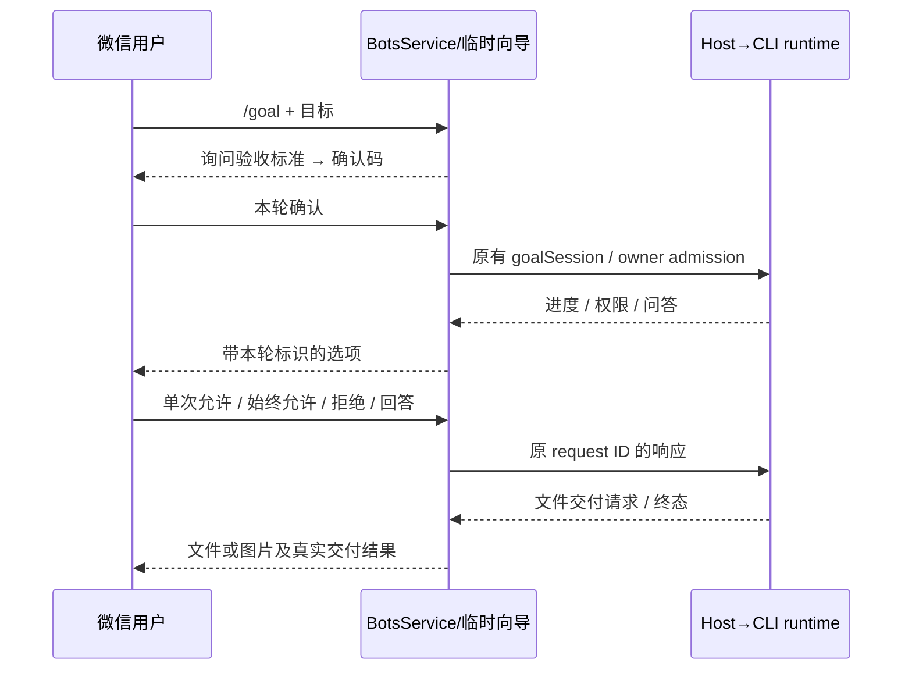

# 微信专属工作区与长程任务

## 规则
微信新上下文默认使用应用数据目录下按 Bot ID 哈希隔离的专属工作区；旧会话和显式选定项目保留，使用 /wechat 切回专属目录。既有账号和工作区白名单仍需校验，不因专属目录绕过限制。

/goal 引导收集目标和验收标准，展示确认码后才能启动；复用 IZCodeTaskService.goalSession，不把 slash 命令发给模型。支持 show/pause/resume/clear；替换目标也先确认。微信新任务采用 build 权限模式，修正旧 Bot 全部强制 yolo 导致权限绕过的问题；旧任务 /goal 设置目标前恢复 build。其他 Bot 渠道行为不变。普通问答、覆盖确认、单次/持续权限选项沿用运行时请求，微信回复绑定本轮 token，持续授权的实际范围由运行时确定。

/clean（/清空）只清空微信专属目录的文件；/clear 保持原有新建对话语义。确认码绑定账号、Bot、工作区和当前任务，五分钟失效，取消/切换/重启失效。禁止在非专属目录、远程目录或任务运行中清空，禁止跟随目录符号链接。再次确认前重新检查路径与任务状态。清空后重置当前草稿，保留应用配置、账号和历史任务记录。

长程任务通过已有文件工具向当前微信接收方交付文件；图片生成显式指定模型时遵从指定，否则读取系统 Studio 默认图片模型。不得使用聊天模型代替生图模型。交付成功 ACK 后才报告成功，不自动重发不确定结果。

## 所有者与顺序
BotsService 持有现有上下文和鉴权；引导器只保存临时表单与确认码，不保存第二份 goal 状态。CLI/runtime 保持目标状态、续跑、预算、权限和任务队列的唯一所有者。SettingService 是图片默认模型唯一所有者。

## 验收
覆盖独立目录、旧会话不迁移、限制白名单、goal 不走普通 prompt、引导确认/取消/过期/重放/跨账号隔离、运行中清空拒绝、非专属目录拒绝、符号链接与路径替换拒绝、两次确认仅执行一次。验证权限 token 不误答新请求、持续授权保留原选项范围，默认图片模型与指定模型、文件/图片回传失败不伪报成功。跑服务与协议测试、类型/Lint/架构检查；未做真实微信付费模型和端到端消息测试时明确说明。

## 首次确认可选择 Yolo

按用户补充，目标启动确认和微信权限询问提供明确的“本任务 Yolo”选项。默认 build；显式选择后仅调用当前 task 的 setMode(yolo)，不写全局或其他任务配置，不将“同类操作始终允许”混同于 Yolo。权限询问切换需匹配当前 actor 的 token/request ID，并复用该请求的单次允许选项完成回答；旧 token、跨任务或已处理请求不能改变模式。

## 微信默认文本模型

- 设置 → 微信控制 → 对应账号提供默认模型，复用 `BotConfig.currentOptions.modelSelection`，Bot 配置是唯一持久化所有者。
- 未指定时跟随系统默认；指定后用于新对话、`/new`、`/goal` 新建任务。任务内显式 `/model` 优先；已运行任务不被设置更新改写。生图仍由 Studio 图像模型设置管理。
- 顺序：设置组件 → BotsService.saveBot → Bot 配置；新任务 → 草稿初始化 → 模型选择服务验证 → 既有任务创建。不得改写全局模型偏好。
- 验收：设置选择/恢复系统默认；配置持久化；goal 创建使用指定 provider/model；新对话不继承上一任务临时模型。

- 默认思考强度保存在同一 Selection.options.reasoningLevel。设置仅列出模型支持的档位；微信 `/think`、`/思考` 列出档位，`/think <档位>` 修改当前任务/草稿，沿用既有配置命令校验。帮助说明作用范围。不支持的档位不得透传。

## 微信确认与补充输入修复

- 数字缺少轮次码、旧轮次码均不得进入模型或自动批准。当前菜单存在时返回明确提示并重发当前菜单；菜单已丢失但持久化权限仍待答时，提示返回桌面处理，不能把数字送入意图分类。
- 普通输入的意图分类：已有 task 先由原 workspace 的 TaskService.resumeTask 恢复，再读取原模型。不创建新会话、不更换默认模型。
- 运行中补发附件走已有 sendPrompt / CommandInbox admission，仍绑定原 task，绕过生图意图分类；下载失败明确返回错误。文字引导继续使用 guideTask。
- 事件顺序：入站 → 权限菜单校验 → 原任务运行状态 → 附件缓存 → 原会话 CommandInbox。Bot 不建立第二份已接受队列。
- 保留按凭据互斥的轮询锁；双进程并存本身不是重复消费的证据。

## 冷启动续问与交付记录

- getTaskModelSelection 接受可选 workspacePath/workspaceIdentity：明确上下文时直接读取该 session，不能要求调用者预先填充进程内 target map；旧调用仍兼容已加载 target。
- 续问分类不得删除 pending/failed/sending 文件记录。权限事件只更新当前 task 的权限字段，不以旧 stream 闭包覆盖最新文件交付状态。
- 成功文件发送以 sendFile ACK 为准；PDF 路径链接不是交付凭据。
