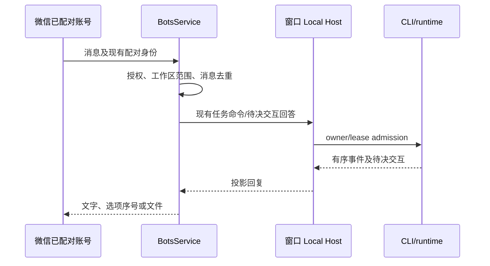

# 微信移动控制入口

## 产品规则

- 桌面工作区的“手机控制”主入口使用仓库已有的微信配对与微信 Bot 会话。点击入口打开微信配置或已配对账号，不创建第二套配对身份或手机 Agent。
- 飞书、Lark、Telegram 继续留在通用机器人管理中；手机控制主界面只引导微信。现有 Web 远控链路保留以兼容已有连接与重放语义。
- 微信消息先经过现有授权账号及工作区白名单校验，再进入现有 Host attachment 和任务运行时。任务、权限、问答和文件选择的事实源仍在 Host/CLI；微信只投影及提交用户操作。
- 微信无法承载 IDE 图形窗格。进度和文件计划以有界文本、序号选择和明确提交呈现；不能声称微信已显示 IDE Diff 或预览。
- 文件选择的微信回复使用本轮短 token 绑定 request ID：回复 `<token> <序号>` 勾选，回复 `<token> 0` 取消。裸序号不能回答文件选择，避免上一轮延迟消息误触新计划。

## 所有者、接口与事件顺序

微信轮询锁、入站消息 ID 与现有交互 request ID 分别负责单实例、消息去重和待决回答幂等；Web 手机链路仍使用原有 `web-remote-replayable` 快照恢复。微信轮询失败不另起运行时，配对失效须重新配对。

## 验收

1. 工作区手机控制入口只展示微信主操作；已存在的微信账号进入同一配置，未配对账号走原有扫码流程。
2. 已配对微信切换工作区与任务、发送消息、停止任务、确认或取消待决问答后，桌面同一任务显示对应事实；未授权账号和越界工作区被拒绝。
3. 文件选择多选在微信中以编号勾选和提交，断线后重放同一待决请求；旧编号不能误答新请求。
4. Web 手机远控既有 attachment、snapshot 和 gap repair 保持兼容。

## 当前边界

已收敛桌面入口，并为文件选择加入本轮 token 校验；微信裸数字或旧 token 不能勾选、提交或以裸 `0` 取消新计划。真实微信账号的端到端配对、消息、断线恢复和跨设备状态验收仍需单独完成；入口改名不代表这些场景已经通过。
