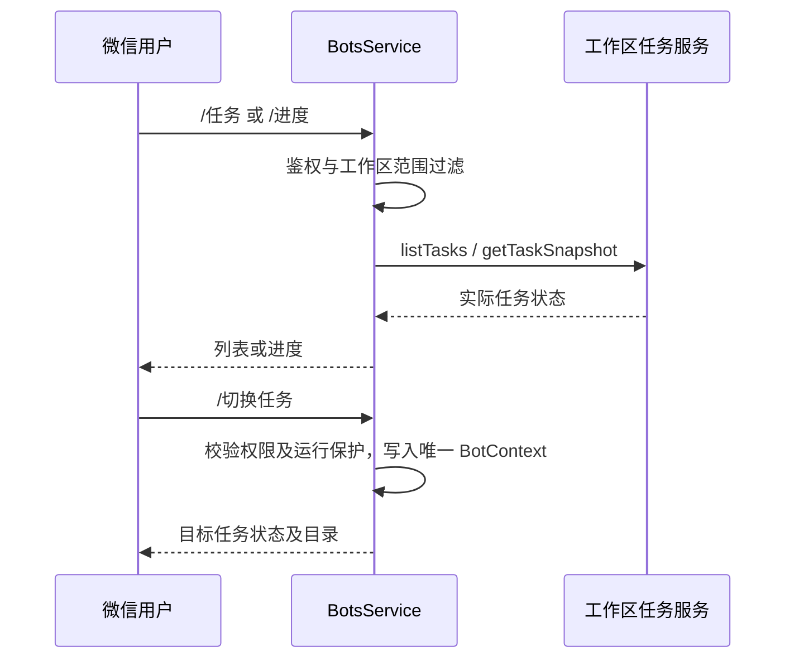
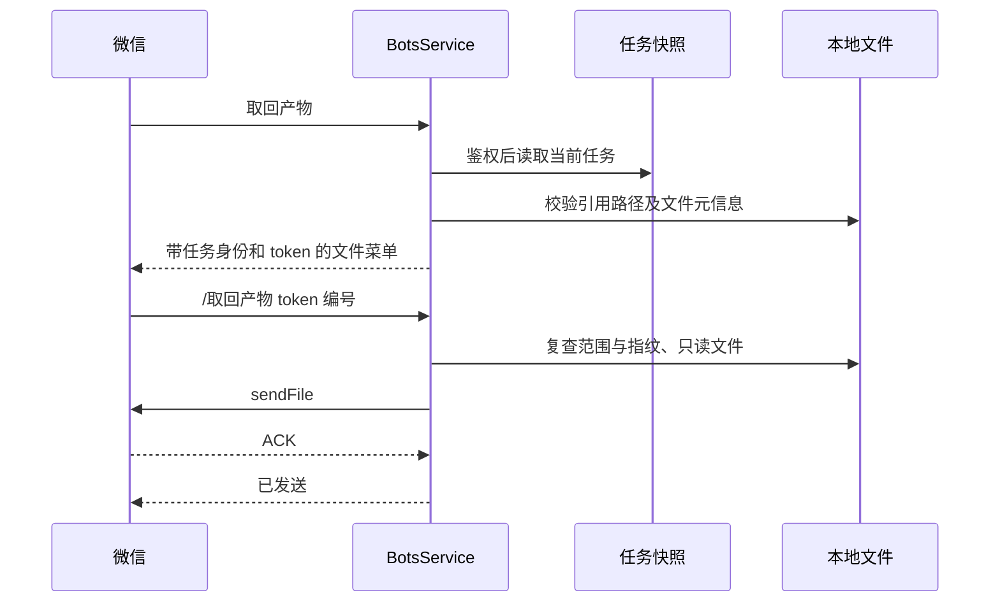

# 微信任务导航

## 产品规则
- `/任务`、`/tasks`、`/task` 查看有权限访问的项目任务；菜单显示目录和真实状态。
- `/切换任务 <任务ID或菜单选项>` 复用 task.set，同步切换任务及 workspaceIdentity/workspacePath。
- `/进度`、`/progress`、`/状态` 查看当前任务真实状态、耗时、最近执行步骤，不推测完成百分比。
- 精确问句“有哪些任务”“当前有哪些任务”“任务进展到哪里了”“当前任务进度”直接路由管理命令，不消耗模型请求。其他文本保留普通对话语义。
- 运行中或等待权限/提问回答时，任务列表仅提供只读文本，不覆盖待确认交互。先 /停止 再切换其他任务。
- 仅查询允许的工作区；断开的远端不回退到本地，不因单个连接异常阻断其他项目。
- 菜单使用工作区身份+taskId 区分同 ID 任务。切换清除旧任务的权限、提问和文件待发送状态。

## 所有权与顺序

任务事实继续由现有任务服务持有；BotContext 仅持有当前路由，菜单为临时投影。不新增运行队列，不改变 desktop continuous / web replayable 协议。

## 验收
中文/英文别名和精确自然问句正确解析；运行中查询不发模型请求、不覆盖权限；跨项目菜单保存身份；切换返回真实状态；原微信目标与文件回传回归通过。

## 按名称切换
`/切换任务 <名称或关键词>` 优先精确 ID，其次规范化后的完整标题，最后标题包含匹配。标题使用 NFKC、忽略空白和大小写；多个关键词允许按顺序出现。唯一匹配才切换；同名或多个包含匹配返回候选菜单，保留目录用于区分，不自动选首项。不匹配则保持原上下文。沿用既有权限过滤及运行保护，不请求模型。

## 历史产物取回
- `取回产物`、`取回以前任务的产物`、`/产物`、`/artifacts` 查询当前选中任务；必须先切换到对应历史任务。
- 查询与发送不经过意图模型、不 resume/guide 任务，不写入原文件。BotsService 鉴权后读取该任务快照；从助手消息链接及已完成工具引用提取常见交付格式文件（最多 100 项），不递归扫描电脑。
- 候选仅限当前本地工作区及系统临时目录中的已存在普通文件；临时文件必须在该任务记录中出现。远端任务明确提示暂不支持本地回传，不作本地路径降级。
- 总是先显示候选名称、路径、大小，再用 `/取回产物 <token> <编号>` 发送。候选由服务内存持有，绑定 actor/task/workspaceIdentity，五分钟过期；重启、切换任务或文件内容时间/大小变化使选择失效。独立菜单不覆盖权限询问。
- 发送前复查 realpath 范围、普通文件、20MB 上限与快照指纹；只有微信 sendFile ACK 后确认成功。错误明确显示，不恢复模型执行或自动重建文件。
- 找不到历史文件时说明可能已清理或历史记录未包含路径；不宣称已找回。隐私文件/目录不作为可回传候选。

