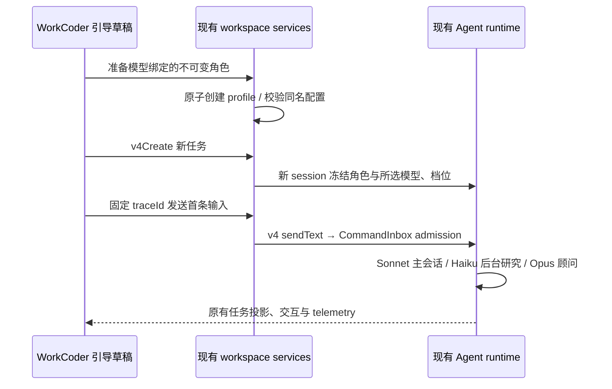
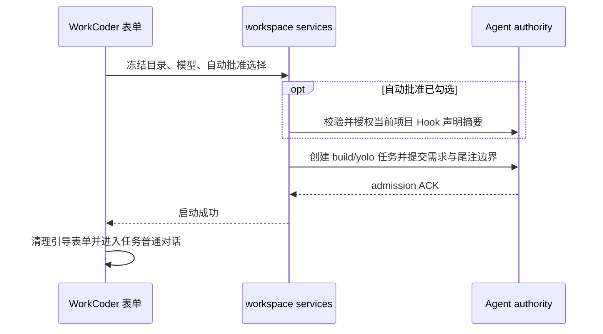
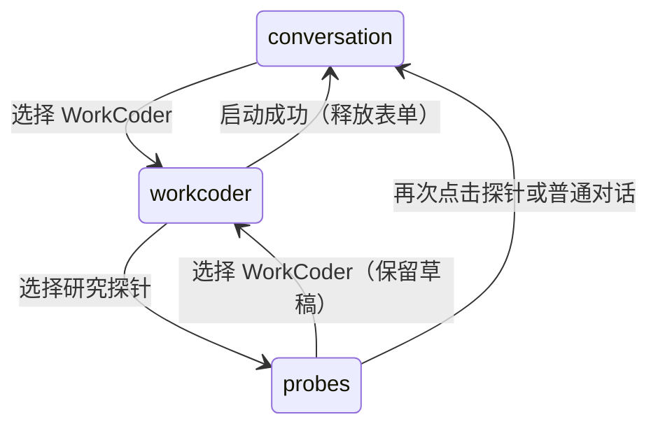

# WorkCoder 工作区与研究探针

## 产品规则

WorkCoder 在 Composer 提供常驻入口，以“分配角色 → 描述任务 → 确认启动”引导创建独立任务。默认主会话 anthropic/claude-sonnet-5.5、只读研究 anthropic/claude-haiku-5.5、顾问 anthropic/claude-opus-5.5，思考强度默认优先 low，用户可分别改选该模型支持的档位；不支持 low 时采用现有模型档位默认规则。用户从当前 Host 的模型目录指定每个角色的 provider/model；目录缺失或没有可用档位时拦截最终启动，仍可继续填写任务。

通过现有 SubagentsService 创建 workspace scope 的不可变角色配置，再通过 ZCodeTaskService 的 v4Create 与 sendPrompt（其内部进入 v4 sendText/CommandInbox）启动全新主会话，避免复用已冻结旧角色的预热会话。所有普通任务、权限、取消、后台 Agent 通知与文件修改仍由现有 runtime 管理。Haiku 仅 Read/Glob/Grep/WebSearch/WebFetch，禁用 Bash/写入/MCP/继续派生。Opus 使用同样只读工具。主会话以 Agent 工具并行委派研究，自己推进计划、代码与验证。

顾问协作规则写入主任务协议和专属顾问 profile：计划敲定前、同一错误第二次出现时、声明完成前。仅交付当前决策所需摘要、定位和验证结果，不复制主会话全文。该规则由 Agent 指令执行，首版不新增 runtime 强制状态闸门。研究结果未返回时不得假定其结论。节省 token 是待验证假设。

## 所有者与顺序

配置文件按完整配置摘要命名，同名必须完整校验；不覆写既有用户 agent。部分准备失败只遗留可复用的角色配置，不发送任务。创建成功但发送失败保留 taskId 与 traceId，重试同一个首条输入，不重复创建会话。切换 workspace 后旧结果不得激活新 workspace。身份一律 workspaceIdentity.trim() || workspacePath，文件操作仍用 workspacePath。

## 两个课题的探针

浏览器内的 ResearchProbeStore 是本机观测数据的唯一所有者，并非任务事实 owner。按 workspace identity 和课题隔离。两个独立开关默认关闭，开关、采样、删除仅影响本机实验。打开后采集既有多 Agent 看板实际执行与 WorkCoder/普通 Agent 的本地 live telemetry，以及设计原型生成/局部修改的操作耗时、失败、取消和重试。关闭/清空后迟到的 span 不得重新写入。使用 caseId、condition 关联实验组，配置在开始时冻结。

Desktop continuous 可获得既有 runtime telemetry；web-remote-replayable 不伪造缺失的 live 数据，不建立额外 Agent。导出标明观测来源及覆盖范围。runtime facts 按 session/eventId 去重，只投影允许的数值字段，不导出路径、提示词、源码、工具参数、错误正文、凭据或 provider 地址。UI span 是本机观测耗时，不代表 server 执行耗时。没有 usage 时记为未知，不估算 token，不混加 terminal tokenCount 与 usage.delta。

本机数据有容量上限并显示截断计数。JSON 与 CSV 带 schema 版本、指标单位、分组与覆盖范围。CSV 防公式注入。图表展示结果数量、操作耗时与已知 token 用量；失败、取消样本必须保留。局部编辑探针不推导未实现的 CAS、冲突检测、区域保持正确率或回退正确率。

## 验收

1. 中英 UI、390/1440px 可打开 WorkCoder 三步入口；模型可以分角色改选，默认 low，不可用配置明确阻止启动。
2. 新会话中两个 profile 模型绑定正确、工具只读，主会话 prompt 明确三个顾问触发条件和并行研究要求。
3. 双击启动只发一次；准备失败不发送；发送失败重试同 task/trace；不同 identity 相同 path 隔离。
4. 探针关闭无数据；两个开关独立；重复 telemetry 不重复计数；关闭/清空阻止迟到事件；导出无内容数据；CSV 可安全打开。
5. 图表与导出来自同一记录。取消、重试、失败、缺失 usage、容量截断和远程覆盖范围可见。
6. 执行 service 回归、探针测试、浏览器 E2E、typecheck、lint、changed architecture 检查。

## 流式 usage 接口

streamZenMuxChatCompletion 新增可选 onUsage。仅订阅 usage 的调用发送 stream_options.include_usage，在 finish_reason 后继续读取 usage 尾帧直到 DONE/EOF。单次请求仅回调最后一个合法累计 usage，禁止把多个累计快照相加。合法字段为非负有限 prompt_tokens / completion_tokens，失败请求已返回的用量同样保留。已有未订阅调用保留原结束行为。探针累计各次实际报告的用量，按已报告请求数与重试数标注 complete/partial/unknown；图表仅显示已知值，不把局部数据解释为完整成本。

## 开发验证记录（2026-11-06）

- 工作树 `/Users/nellertcai/Zcode`，集成分支 `codex/workcoder-integrated`，在已发布 3.14.38 基线上融合进 Zcoder 原项目。
- 使用 Node 24.14.0 与 pnpm 10.33.2。13 项 service/probe/SSE usage 测试通过。
- WorkCoder 中英文浏览器 E2E 通过，覆盖 1440px / 390px、默认优先 low、角色与思考强度改选、无效配置的最终启动拦截、重试同 task/trace、两探针、去重、导出与图表。
- CoDesign 浏览器回归通过，包括实际局部编辑调用链的 usage 尾帧采集、相邻区域保持、导出、取消与旧选区处理。模拟图像占位符触发预览 CSP 拦截属于该测试的既有输出。
- `pnpm typecheck` 通过。`pnpm architecture:check --changed` 通过，0 violations。功能关系图 YAML、ID、端点与新增 source seeds 校验通过。
- `pnpm lint` 实际执行，失败于既有 `packages/services/src/setting/settingService.ts` 的 max-lines（403，限制 400），本次文件无错误。
- 浏览器与服务测试使用合成数据和模拟接口，尚未验证三个指定模型的真实连通性、实际协作依从性或 token 节省效果。模型须先存在于当前 Host 的模型目录。
- 本机探针记录保存在当前窗口内存，刷新会清空，应先导出；不增加远端业务状态或 replay 数据源。
- 变更规模（不含本 spec）新增 1747 行、删除 60 行，净增 1687 行。

## Zcoder 主项目集成

WorkCoder 是现有 ConversationComposer 内的工作区入口，研究探针同样在输入区提供入口。两者共享 Zcoder 的 ServiceProvider、workspace identity、Agent/task runtime、权限与任务导航。实现已合并到原项目目录，不增加独立应用、启动器或单独运行服务。原有本地 UI 与测试改动已通过逐文件三方合并保留。

## 角色思考强度修正

每个角色独立选择思考强度，选项来自该角色选中的 provider/model 的 reasoningLevel.values，并复用现有 supportedEfforts 过滤与档位文案。默认优先 low；模型不支持 low 时复用现有 resolveEffort 选择支持的默认档位。模型切换后重置该角色的档位选择，避免跨模型沿用不受支持的值。

“下一步”允许继续填写任务，模型尚未就绪时在确认页拦截启动，并提供返回调整模型的入口。未知模型不得静默替换为其他模型。所有角色的模型与思考强度在启动时冻结，主会话、workspace Agent profile、重试首条输入均保留同一份选择，服务层不得再硬编码覆盖 low。

验收包括只支持 none/high 的模型、同名模型属于不同 provider、用户显式选择不同角色档位、模型切换重置、未知模型可继续填写但无法启动、失败重试沿用原配置。通过服务与中英文桌面/手机浏览器回归验证。

## 工作目录、无需思考及入口分离

启动前在任务填写页提供工作目录路径与本机目录选择器，默认当前 workspacePath。远程任务沿用当前 attachment 的路径与 identity，在本流程中不把本机目录换成远端 identity。服务在创建角色或任务前解析本机路径并验证目录存在，重试与任务导航使用冻结的实际工作目录；启动成功激活该目录的项目页及正常任务会话。

Haiku 研究角色默认无需思考。缺失指定 Haiku 模型时，确认页显示“配置并启动”，在用户选定的主模型供应商中通过现有 ProviderSettingsService 添加该指定模型，使用 reasoningLevel values=[none]、map={}，刷新现有 ModelSelectionService 后提交；并发添加时重读 Registry，只复用已存在的目标配置。禁止静默换用其他模型、伪造 Registry 项或新增鉴权信息。只有目录有效且其余角色选择有效时允许配置并启动。

所有模型的公共思考设置组提供“无需思考”预设，复用原草稿与保存路径，将档位设为 none、映射设为空请求对象。该配置表示接口请求不发送思考参数，不保证模型内部推理行为。WorkCoder 以及原始设计/讨论请求应识别这种显式配置。研究角色可以使用其他可用模型，其显式档位选择仍按前述规则处理。

普通对话与 WorkCoder 使用两个独立入口与界面。切到 WorkCoder 后显示其任务表单和启动入口，普通聊天输入保留草稿并隐藏；返回普通对话恢复原输入。研究探针有独立按钮，不嵌入 WorkCoder 表单。

验收覆盖目录选择取消、指定不同目录、无效目录不创建任何任务、目录冻结后失败重试、无需思考配置的草稿保存/加载及空参数映射、缺失 Haiku 的明确配置并启动、中英文与手机宽度下两个入口的互斥显示及草稿保留。

## 本轮验证补充

18 项服务、探针、无需思考参数和 SSE 回归通过。中英文 WorkCoder 浏览器回归覆盖目录选择取消/选定、目录传入任务、缺失 Haiku 的配置并启动和原输入重试。模型设置浏览器测试在 Claude、GPT 和自定义模型上均验证预设可保存、映射生成空请求参数。开发版界面已观察到普通对话与 WorkCoder 两个独立入口。远程目录选择保持当前 attachment 边界，需打开对应远程项目后启动。

## 启动交接、内部说明与自动批准

WorkCoder 的启动 ACK 成功后，由启动 Hook 回调通知 Composer 退出 WorkCoder，释放引导表单并激活实际任务的普通对话输入，供用户继续 Guide。提交失败保留表单与同一待重试输入。切换不取消已接受任务、不把 UI 状态当作运行状态。

新增任务正文以用户需求开头，协作协议放在引擎附加说明中，沿既有 epilogueStart 语义默认折叠。新增 sendText.epilogueStart 是 UTF-16 偏移，必须在 text 范围内；只用于 idle start-now 输入，核心 admission 需 requireIdle，不能因时序竞争静默转入丢失边界的队列。复用 Core 已有尾注持久化和 desktop/mobile hydration。会话初始标题及自动标题只取需求正文。旧 v1 头部仅在完整匹配已生成协议前缀及角色标记时按旧格式剥离展示，不改写历史存储或任意普通用户文本。

任务设定页新增“自动批准”，默认关闭，确认页展示选择。关闭使用 build；开启使用既有 yolo 任务模式，角色的只读工具白名单仍由 profile 限制。开启时通过现有 HooksService/Agent authority 对所选目录当前启用的 Hook 声明摘要逐一授权，沿用精确快照、策略拒绝、撤销和损坏 store 规则。该授权保存到该项目 Hook 的既有信任记录，界面明确告知，不能修改全局批准模式或绕过企业策略。

验收包括成功后隐藏引导并显示对话、失败时保留、默认关闭和开启后的 mode/Hooks 调用、策略拒绝不创建任务、尾注偏移校验、引擎文本在 live/replay 中默认折叠、旧协议头部兼容及普通正文保留。

本轮验证：20 项 WorkCoder、代理与消息展示单元测试通过；中英文桌面/手机尺寸浏览器回归通过，覆盖自动批准默认关闭、开启后 yolo、启动成功回调与失败重试。根 typecheck、CLI bootstrap 及依赖构建通过；Lint 76 个既有警告、0 错误；架构检查 0 违规。未执行付费模型真实任务，未强制重启用户已运行的 Agent。

## 入口栏与历史输出隔离

WorkCoder 与研究探针位于 ConversationComposer 管理的 sticky dock 内。整个 Composer（含入口栏、面板间距及输入区）必须使用不透明的页面背景，防止离底滚动或切换面板时历史输出从透明空隙透出。继续复用 Timeline 的滚动与 dock 所有权，不新增滚动状态或延时修正。验收覆盖浅色/深色、桌面/窄屏、滚动时面板展开/收起；消息不透过入口栏，控件仍可点击。

重叠修复验证：浏览器使用实际 Composer 根样式验证浅/深色、390/1440 宽度及滚动中反复展开/收起面板，背景 alpha=255、入口栏包含于遮挡区域且可点击。该夹具验证 sticky 绘制边界，不替代完整任务会话 E2E。typecheck、Lint（76 warnings/0 errors）、架构检查通过。

## 入口互斥切换

入口可见状态由 Composer 的单一 navigation Hook 拥有，取值 conversation/workcoder/probes/workspace/studio；不再用多个布尔值组合出同时展开的面板。选择入口只显示对应区域，普通对话清除辅助面板选择；研究探针再次点击回到普通对话。切换保留已挂载 WorkCoder 草稿，启动成功才释放表单。研究探针开启时也隐藏普通输入壳，避免垂直堆叠。探针记录开关不受面板可见性影响。

验收：连续切换三个入口时最多一个主入口选中、最多一个辅助面板可见；WorkCoder 草稿保留，任务启动成功清理；工作区与创作同样不能与探针并排展开。

本次验证：导航 Hook 浏览器交互回归在 390/1440 宽度通过，覆盖跨五类入口连续切换、唯一选中/唯一可见面板、草稿保留、探针再次点击收起及启动成功清理。该测试使用实际导航 Hook 与合成面板；未在用户的真实运行会话中操作。typecheck、Lint（76 warnings/0 errors）、架构检查通过。

发布验收修正：首次使用引导 E2E 在英文宿主上不能硬等中文欢迎页。测试在隔离 profile 中显式保存 zh-CN 偏好并刷新；Linux CI 的禁用沙箱开关仅传给测试子进程。测试进程 cwd 使用独立临时目录，避免从源码借运行时。该修正不改变产品语言策略。
