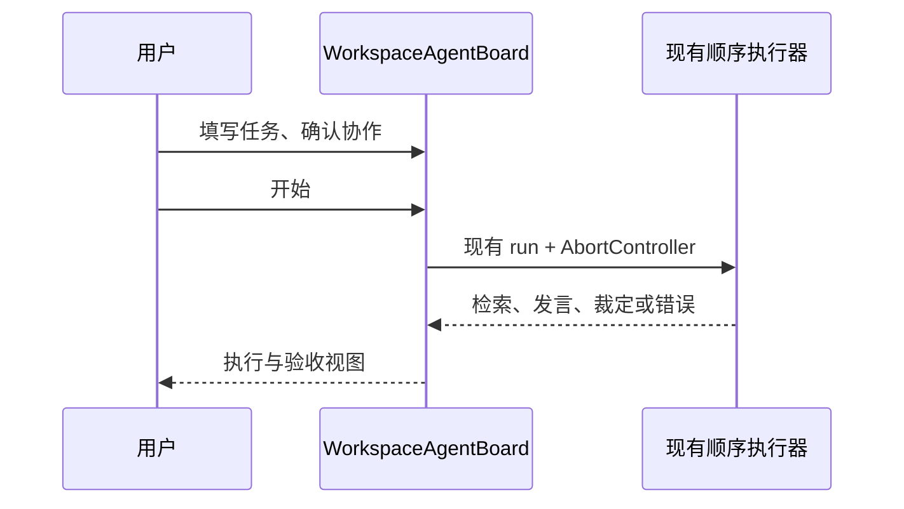

# 多 Agent 工作区引导入口

## 产品规则

- 首屏仅显示任务说明、附件和下一步。流程为描述任务 → 确认协作 → 执行与验收。第二步展示协作摘要和可展开的人员、裁定、白板配置，再由用户点击开始。
- 检索证据和讨论结果位于任务与配置之后，不把正在增长的检索列表插到任务输入之前。讨论结果只在配置区域之外的共享结果区展示一次，按 Agent 发言顺序和裁定结论更新。收起配置不隐藏已产生的结果，运行中也能看到流式发言。
- “添加 Agent”属于人员配置，达到上限或运行期间不可添加。已有任务输入、附件与结果不因配置展开/收起而重置。

## 状态与时序

- `WorkspaceAgentBoard` 继续唯一拥有本次任务输入、附件、运行状态和输出；现有本地草稿持久化仍只保存人员、裁定和白板配置。展开状态由原生 `details` 持有，不进入服务端事实。
- 点击开始 → 清空旧结果 → 顺序检索与发言 → 裁定 → 在共享结果区持续投影 `outputs`。取消保留已产生内容。配置展开不触发新的模型调用。
- 不改变 ZenMux 调用、搜索、导出接口、Agent 数量上限或模型选择语义。

## 验收

1. 首次打开时可直接看到任务输入和下一步；输入任务后进入确认协作阶段，开始操作在此阶段可见；添加 Agent 仅在展开配置后可见。
2. 启动讨论后不展开配置也能看到发言和裁定；展开配置不会出现第二份重复的发言正文。
3. 运行中取消、收起配置、切换桌面与移动宽度，结果仍可读且不遮挡主操作。

2026-11-04 组件浏览器场景加载真实 Tailwind 样式后，在 320px 视口检查第一步任务输入、下一步按钮可见且文档无水平溢出；发言与裁定各只出现一次。此检查不代替手机 Web 的整页和远控连接验收。

## 分步引导（2026-11-04）

- WorkspaceAgentBoard 唯一持有阶段、草稿和运行状态。阶段只属于窗口 UI，不持久化为业务事实。返回修改保留输入、附件、配置和已有结果。
- 运行时停留在执行与验收阶段，禁用步骤切换；停止和导出位于此阶段，错误在各阶段可见。任务摘要显示本次输入。取消保留部分输出，允许返回再运行。
- 历史结果在重新开始前保持，只有既有 run admission 清空旧结果。

验收覆盖空任务不可前进、返回保留草稿、配置仅第二步、运行时可停止、第三步可查看结果及导出、320px 无横向溢出。

### 本轮验证

使用 Node 24.14.0 执行 `node --test packages/ui/tests/workspace-agent-board-guidance.e2e.mjs` 通过，覆盖空任务校验、第二步配置、返回草稿保留、唯一结果区、裁定和 320px 无横向溢出。完整 Typecheck 与架构检查通过；完整 Lint 的既有错误与本轮环境范围见 `studio-media.md` 的“本轮验证”。
